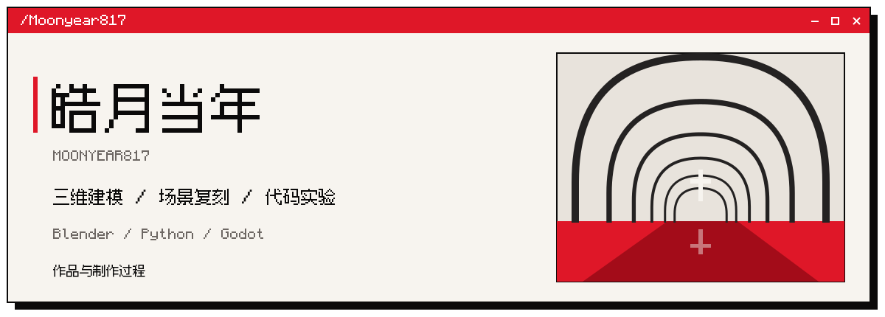

  

这里记录三维建模、场景复刻和代码实验。作品页包含成品图、制作过程与参考说明。

3D modeling, scene reconstruction and code experiments. Explore the projects for renders, making-of notes and credits.

## 作品 / Works

[罗德岛号](projects/rhodes.md) · [T-84 向日葵花海](projects/t84.md) · [南宋临安城](projects/linan.md) · [信濃町夜景](projects/night-plaza.md)

## 找到我 / Connect

[X](https://x.com/moon_year556) · [Instagram](https://www.instagram.com/huangyihao817/) · [哔哩哔哩](https://space.bilibili.com/627291386)

微信 / WeChat

  

用微信扫一扫，添加好友。 / Scan with WeChat to add me.

