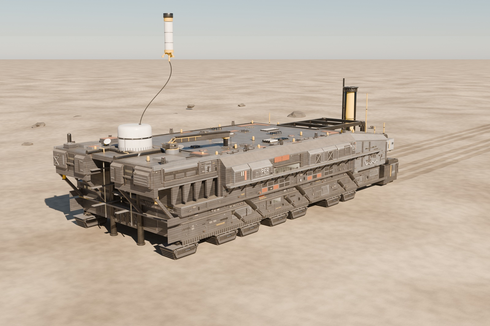
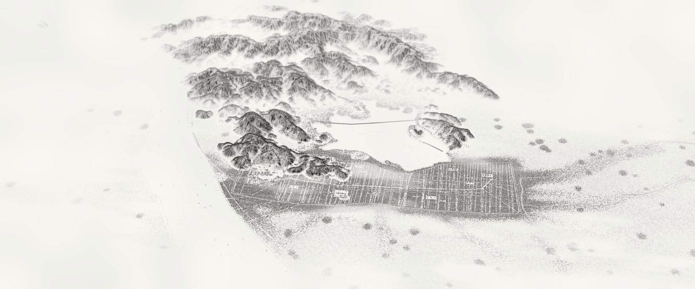
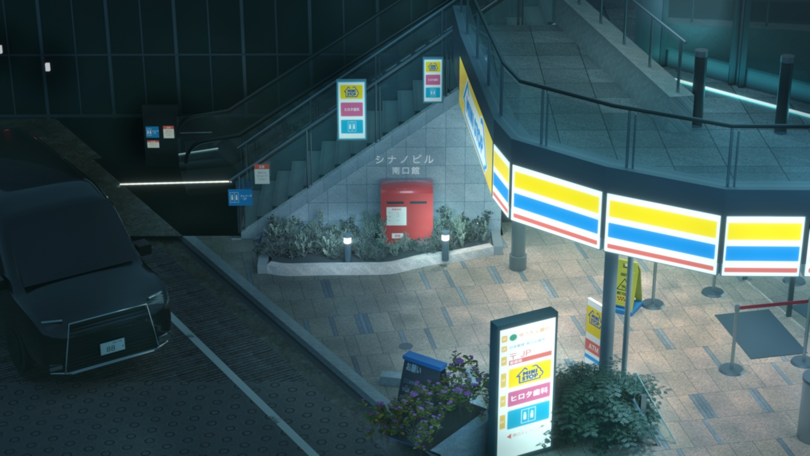

  

这里记录三维建模、场景复刻和代码实验。作品页包含成品图、制作过程与参考说明。

3D modeling, scene reconstruction and code experiments. Explore the projects for renders, making-of notes and credits.

## 作品 / Works

<table>
<tr>
<td width="50%" valign="top">

<h3><a href="projects/rhodes.md">罗德岛号</a></h3>

陆行舰复刻、钢板材质与灯光。

</td>
<td width="50%" valign="top">

<h3><a href="projects/t84.md">T-84 · 向日葵花海</a></h3>

坦克建模、花田场景与胶片色调。

</td>
</tr>
<tr>
<td width="50%" valign="top">

<h3><a href="projects/linan.md">南宋临安城</a></h3>

古城布局、程序化建筑与水墨合成。

</td>
<td width="50%" valign="top">

<h3><a href="projects/night-plaza.md">信濃町夜景复刻</a></h3>

照片机位匹配、材质与夜景灯光。

</td>
</tr>
</table>

## 找到我 / Connect

[X](https://x.com/moon_year556) · [Instagram](https://www.instagram.com/huangyihao817/) · [哔哩哔哩](https://space.bilibili.com/627291386)

微信 / WeChat

  

用微信扫一扫，添加好友。 / Scan with WeChat to add me.

