  

<a href="https://moonyear817.github.io/">个人主页 / Website ↗</a>

**作品**　[完蛋指数](projects/wandan-index.md) · [Yufi 桌面助手](projects/yufi.md) · [罗德岛号](projects/rhodes.md) · [T-84 向日葵花海](projects/t84.md) · [南宋临安城](projects/linan.md) · [信濃町夜景](projects/night-plaza.md)

**公开仓库**　[完蛋指数](https://github.com/Moonyear817/wandan-index) · [Yufi](https://github.com/Moonyear817/Yufi) · [Canvas 课件同步 · Codex](https://github.com/Moonyear817/kean-canvas-sync-codex) / [Claude](https://github.com/Moonyear817/kean-canvas-sync-claude) · [QQ 本地聊天归档](https://github.com/Moonyear817/qq-nt-mac-local-vault) · [微信数据库工具](https://github.com/Moonyear817/wechat-key-macos27-lldb)

**制作笔记**　[履带布局](projects/rhodes.md#从大体块到机械细节) · [85 mm 与花田](projects/t84.md#花田与长焦构图) · [水墨合成](projects/linan.md#从渲染通道到水墨画面) · [照片相机标定](projects/night-plaza.md#从照片反推相机)

  
  
  

微信 / WeChat

  

用微信扫一扫，添加好友。 / Scan with WeChat to add me.

