  

  <a href="projects/rhodes.md">罗德岛号</a> ·
  <a href="projects/t84.md">T-84 向日葵花海</a> ·
  <a href="projects/linan.md">南宋临安城</a> ·
  <a href="projects/night-plaza.md">信濃町夜景</a>

  
  
  

微信 / WeChat

  

用微信扫一扫，添加好友。 / Scan with WeChat to add me.

