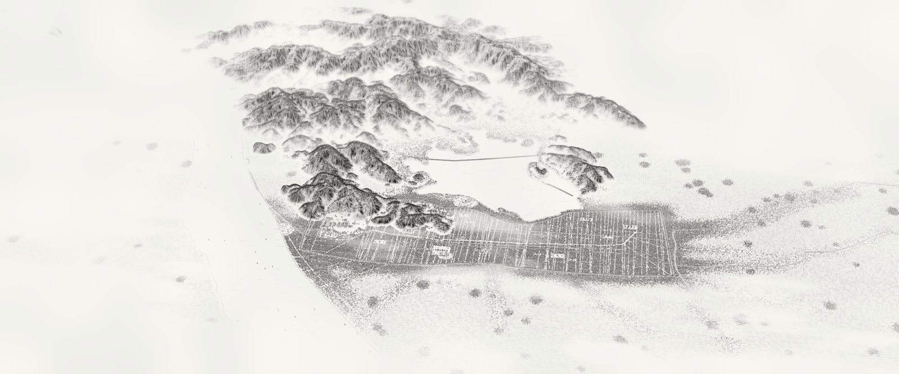
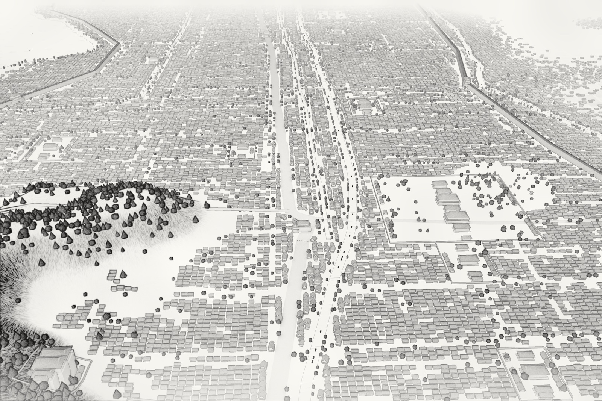
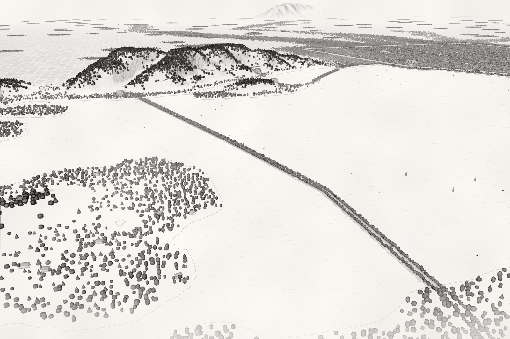
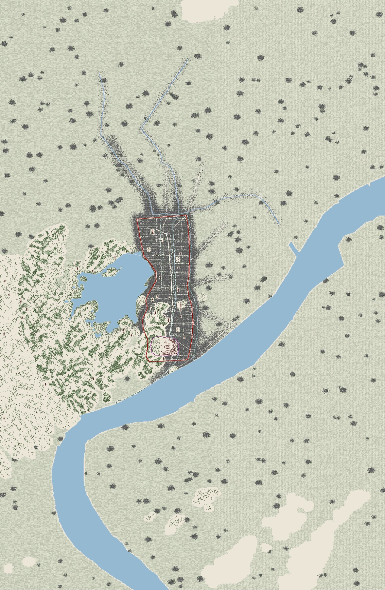
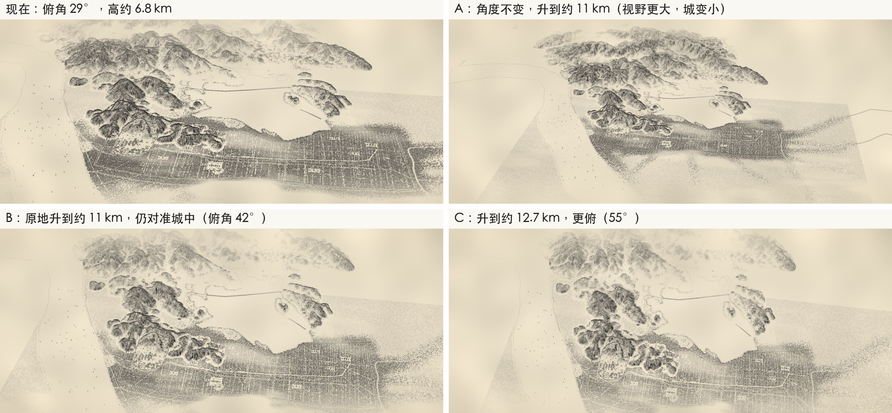

# 南宋临安城

Southern Song Lin’an

[返回作品集 / Back to portfolio](modeling.md)

## 项目介绍

参考南宋古地图，并结合现代地形与地理锚点搭建临安城和西湖。通过三维场景与后期合成呈现水墨全景，以及御街、城门和苏堤等局部。复原中的尺度与位置包含解释性取舍。

A reconstruction study of Lin’an and West Lake based on historic maps, modern terrain and geographic anchors. A 3D scene and compositing produce an ink-wash panorama and architectural details, with interpretive choices in scale and placement.

**工具 / Tools**　Blender · Python · EEVEE · NumPy

## 成品展示 / Gallery

临安城与西湖全景 / Panorama of Lin’an and West Lake

御街与朝天门 / Imperial Street and Chaotian Gate

苏堤六桥 / Six bridges of Su Causeway

## 制作过程 / Making of

### 古地图与现代地理对齐

以《咸淳临安志》地图和古城复绘为依据，结合现代遗址位置、Copernicus 高程与 OpenStreetMap 水系道路数据，确定城墙、皇城、御街、河道和西湖之间的布局关系。

**Aligning historical maps and geography**

Historical Lin’an maps and later redrawings are aligned with surviving sites, Copernicus elevation data and OpenStreetMap waterways and roads. These anchors establish the relationships between the city walls, palace, Imperial Street, canals and West Lake.

建模阶段的全域布局俯视图，查看城墙、水系与建筑分布。 / Top-down planning view of the walls, waterways and building distribution.

### 程序化搭建城市

先生成地形和城市规划，再按街区、建筑类型与地势批量布置民居、铺面、寺观和宫殿。城楼、雷峰塔等地标单独处理；民居以程序化示意表达城市密度，并保留历史位置存在分歧时的解释性取舍。

**Procedural city construction**

Terrain and a city plan come first, followed by procedural placement of houses, shops, temples and palace buildings. Gates and landmark towers receive individual treatment. Generated housing conveys urban density, while uncertain historic locations remain interpretive choices.

### 机位与全景可读性

通过高低机位比较城市与西湖的关系，确定斜俯瞰的全景视角。为让远景中的山形、塔和城门清晰可辨，对部分高度和尺度进行有记录的夸张，再为御街、苏堤等区域设置局部镜头。

**Camera studies and visual readability**

Camera studies compare how the city and lake read from different heights. An oblique aerial view becomes the panorama. Documented scale exaggerations help mountains, towers and gates remain legible, and separate cameras explore Imperial Street, Su Causeway and other details.

前期全景机位方案，比较俯角与城市覆盖范围。 / Early panorama camera studies comparing viewing angle and city coverage.

### 从渲染通道到水墨画面

EEVEE 分别输出法线、深度、遮挡、底色与分类遮罩。后期从通道变化提取墨线，叠加墨色分层、皴纹、云雾、岸线和宣纸纹理，并按镜头调整浓淡，最终输出 8K 全景与七处景致特写。

**From render passes to ink wash**

EEVEE provides normal, depth, occlusion, base-color and category-mask passes. Compositing extracts ink edges and combines tonal layers, texture strokes, mist, shorelines and paper texture. Per-camera adjustments produce an 8K panorama and seven detail views.

## 素材与参考 / Credits

资料来源包括《咸淳临安志》、G. E. Moule 古城图、Copernicus DEM、OpenStreetMap。

Sources include historic Lin’an maps, G. E. Moule, Copernicus DEM and OpenStreetMap.

