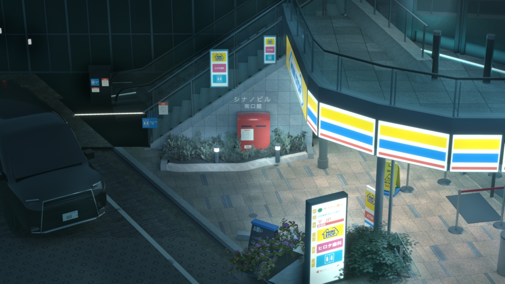
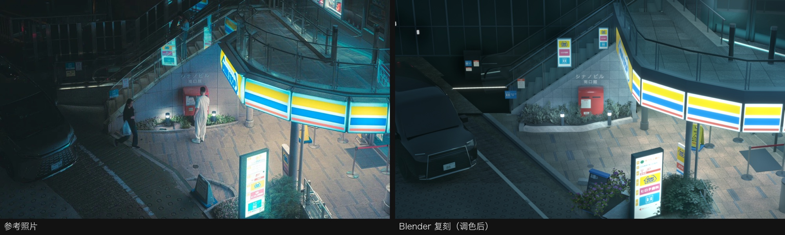
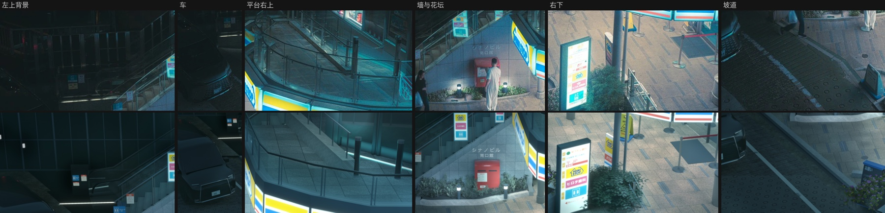
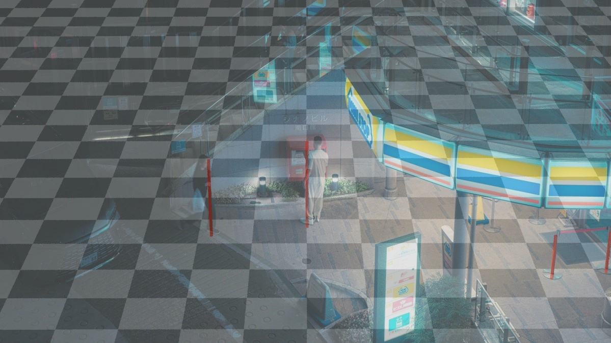
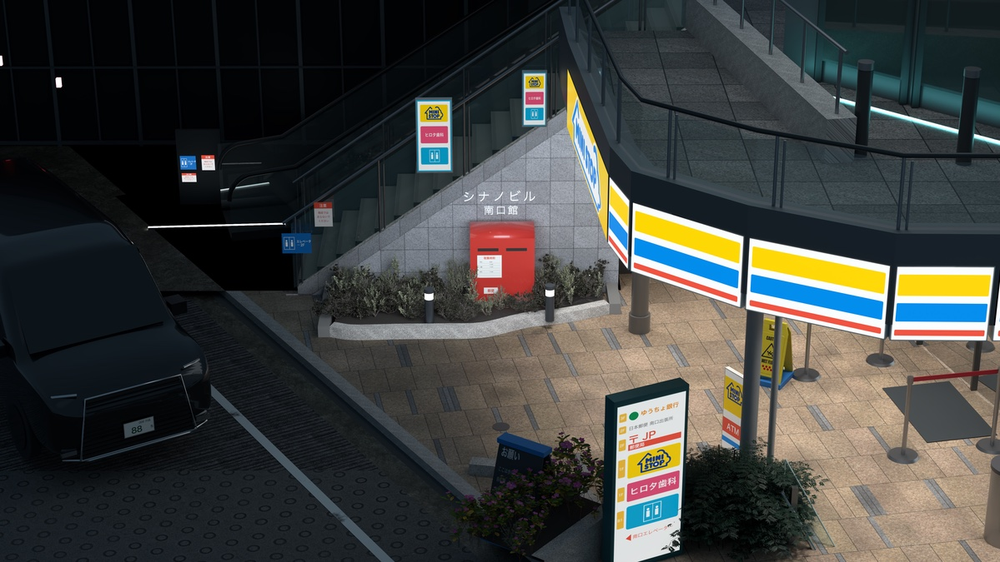

# 信濃町夜景复刻

Shinanomachi · Night Scene

[返回主页 / Back to profile](../README.md)

## 项目介绍

以车站口广场的夜景照片为参考，复刻商店灯箱、石墙、台阶、栏杆与路面等环境细节。通过机位匹配、材质与灯光调整，重现照片中偏青的夜景色调。图组包含终稿、整体对照与局部细节。

A night-scene reconstruction based on a photograph of a station plaza, with shop signs, stone walls, stairs, railings and paving. Camera matching, materials and lighting recreate the cool-toned atmosphere. The gallery includes the final render and reference comparisons.

**工具 / Tools**　Blender · Python · Cycles

## 成品展示 / Gallery

夜景终稿 / Final night scene

参考照片与复刻画面对照 / Reference photograph and reconstructed scene

六处局部细节对照 / Six detail comparisons

## 制作过程 / Making of

### 从照片反推相机

从墙缝、立柱等竖线估计消失点，再利用地面上互相垂直的线反推焦距。确定约 69 mm 的等效焦距和约 9.7 m 的相机高度后，先渲染地面网格与竖杆，叠回参考照片检查透视。

**Solving the camera from the photograph**

Vertical wall joints and posts help estimate the vanishing point; perpendicular ground lines constrain focal length. An approximately 69 mm equivalent lens and 9.7 m camera height are checked by overlaying a rendered ground grid and vertical markers on the photograph.

早期相机核对图，地面网格与竖杆叠在参考照片上。 / Early camera check with a ground grid and vertical markers over the reference photograph.

### 按透视搭建广场

在相机固定后反投影照片中的位置，逐步搭建铺装、石墙、台阶、露台、灯箱和栏杆。对照边缘叠图修正墙体朝向、邮筒高度和楼梯外沿，让关键轮廓与参考更接近。

**Building the plaza from projected measurements**

With the camera fixed, back-projected measurements guide the paving, wall, stairs, terrace, signs and railings. Edge overlays reveal adjustments to the wall orientation, postbox height and stair beam, bringing the main outlines closer to the reference.

### 材质、灯光与暗部层次

铺装、花岗岩、不锈钢和植物结合程序化处理与 CC0 素材完成。将灯箱、店内、地灯和补光分组渲染，按照片分区亮度拟合强度，并分别控制灯箱自身的画面亮度和周围照明。

**Materials, light groups and shadow detail**

Procedural work and CC0 assets provide paving, granite, steel and plants. Separate render groups for signs, shop lighting, ground lamps and fill lights are fitted to regional brightness in the photograph. Visible sign brightness and illumination of nearby surfaces are controlled separately.

调色前的渲染阶段，用于检查材质与各区域的明暗关系。 / Render before final grading, used to inspect materials and regional lighting.

### 色调匹配与局部复核

后期拟合逐通道曲线与大尺度明暗，补入灯箱光晕、轻微柔化和颗粒。压暗楼梯与左上背景后，输出 4796×2700 终稿，再用整体并排图和六处局部对照复核；照片中难以辨认的暗部结构采用推测性简化。

**Color matching and detail review**

Channel curves and broad tonal adjustments establish the final grade, followed by sign glow, mild softening and grain. Darkening the stairs and upper-left background leads to a 4796×2700 final render, reviewed in full-frame and six-detail comparisons. Obscured structures are simplified where the photograph provides limited information.

## 素材与参考 / Credits

场景按参考照片搭建，部分材质与道具使用 CC0／公有领域资源，来源包括 ambientCG、Poly Haven。

Reconstructed from a reference photograph, using some CC0 and public-domain materials and props from sources including ambientCG and Poly Haven.

