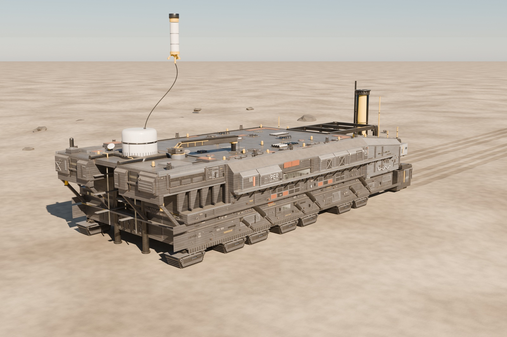
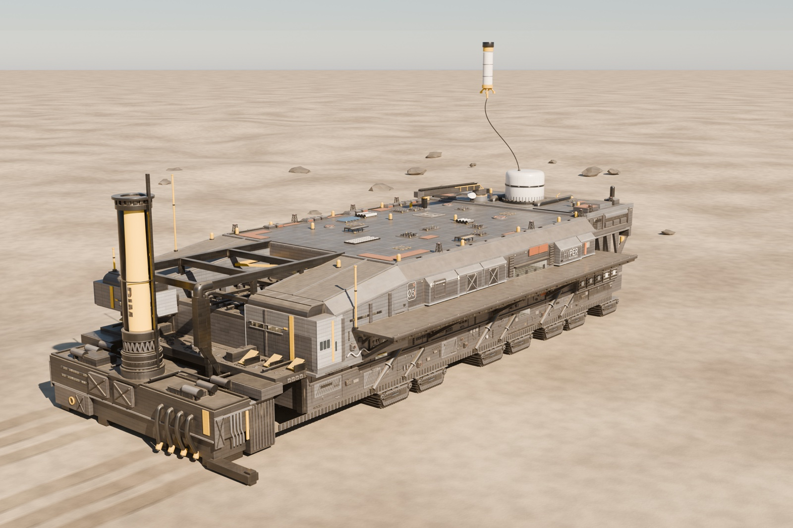
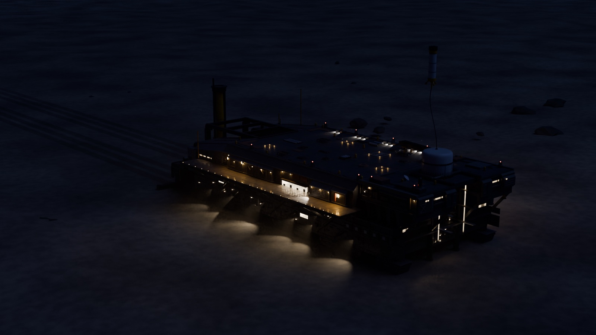
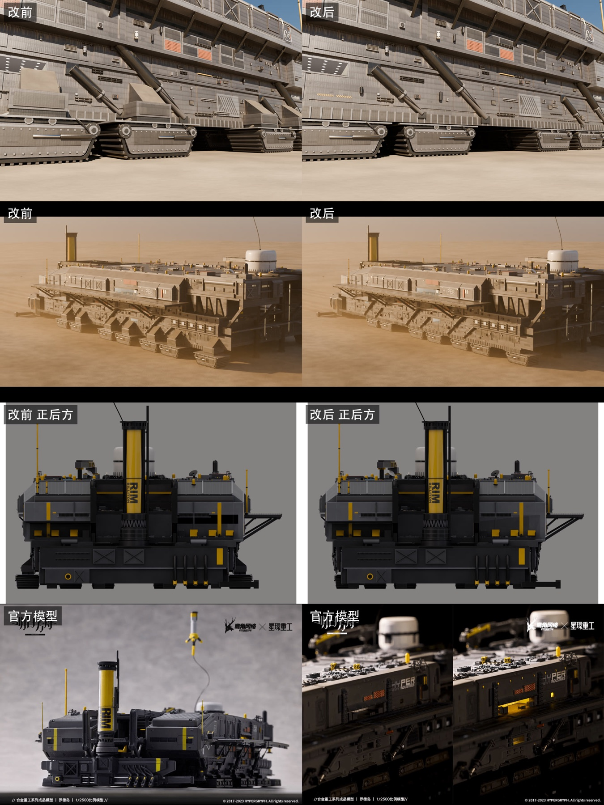
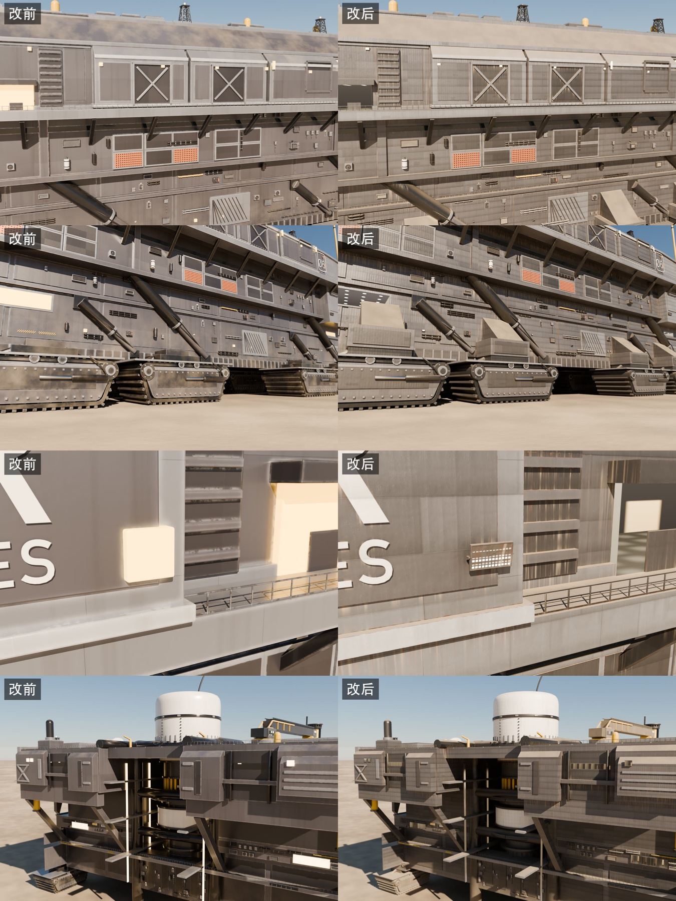

# 罗德岛号

Rhodes Island Landship

[返回主页 / Back to profile](../README.md)

## 项目介绍

以《明日方舟》罗德岛号为参考的陆行舰复刻，围绕舰体比例、分板、履带与灯具逐步完善细节。展示荒原中的完整舰体、船尾与夜间灯光。

A landship study based on Rhodes Island from Arknights, developed through hull proportions, paneling, tracks and lighting. The gallery presents the ship in a desert setting and at night.

**工具 / Tools**　Blender · Python · Cycles · Godot

## 成品展示 / Gallery

荒原中的罗德岛号 / Rhodes Island in the desert

船尾与上层结构 / Stern and superstructure

夜间灯光 / Night lighting

## 制作过程 / Making of

### 参考整理与比例校准

以官方授权成品模型的多角度照片为主要参考，先提取舰体轮廓、甲板层级、烟囱和跑道的位置，再反推照片机位。在相同视角下比较模型与参考，反复校准长度、宽度和上层建筑的高度。

**References and proportions**

The study starts with multi-angle photographs of the officially licensed scale model. Hull silhouettes, deck levels, chimney and runway positions guide the blockout. Fitted cameras make it possible to compare matching views and refine the ship’s proportions.

### 从大体块到机械细节

用 Python 脚本分层搭建主舰体、分板和小构件，逐步加入履带单元、支撑、管线、栏杆和机库。复核承重关系后，将外排履带收回舰体下方，并同步调整支架与沙地车辙的位置。

**From blockout to mechanical detail**

Python scripts build the hull, panel divisions and smaller components in layers. Tracks, supports, pipes, railings and hangars are added after the large forms. A later review moves the outer tracks beneath the hull and updates the supports and desert track marks.

履带位置与支撑关系的修改对照；下方附官方模型参考。 / Track-layout revisions, with official scale-model references at the bottom.

### 舰体材质与灯具重做

材质经过多轮调整，逐步加入钢板明暗、焊缝、补漆、锈水和棱边磨损，让表面在光线下显出板块层次。灯光也从简单发光面改为带灯壳、支架和透镜的灯具，再为夜景配置实际光源。

**Hull materials and lighting**

Several material passes introduce plate-to-plate variation, welds, repair paint, rust streaks and edge wear. The changing reflections help describe the hull’s panel structure. Simple emissive patches are developed into modeled fixtures with housings and lenses, then paired with lights for the night views.

写实化调整前后，比较舰体表面、履带与灯具。 / Before-and-after views of the hull surface, tracks and lighting details.

### 多机位渲染与实时展示

在荒原、近景与夜景中分别检查整体轮廓、材质和细节，再输出展示图。另将材质烘焙并导出到 Godot，检查实时环境中的比例、贴图和舰体层次。

**Rendering and real-time presentation**

Desert views, close-ups and night renders check the silhouette, materials and small details at different scales. Baked materials and a Godot export provide a separate real-time view of the model’s proportions and surface treatment.

## 素材与参考 / Credits

角色与世界观来自《明日方舟》，模型与画面为同人制作。

Fan work based on the characters and world of Arknights.

