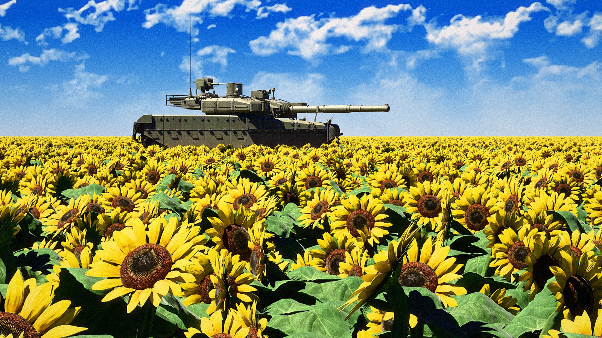
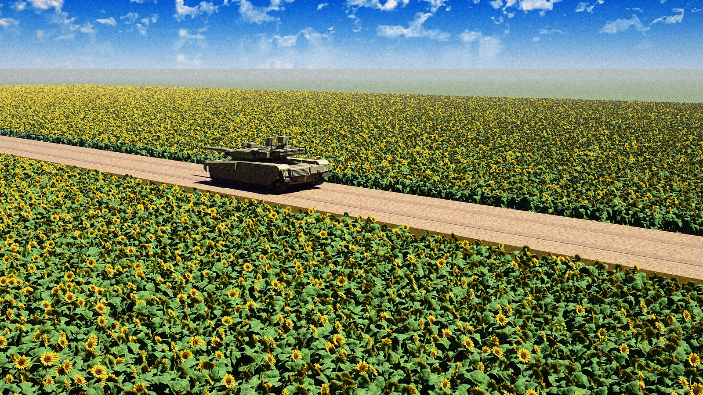
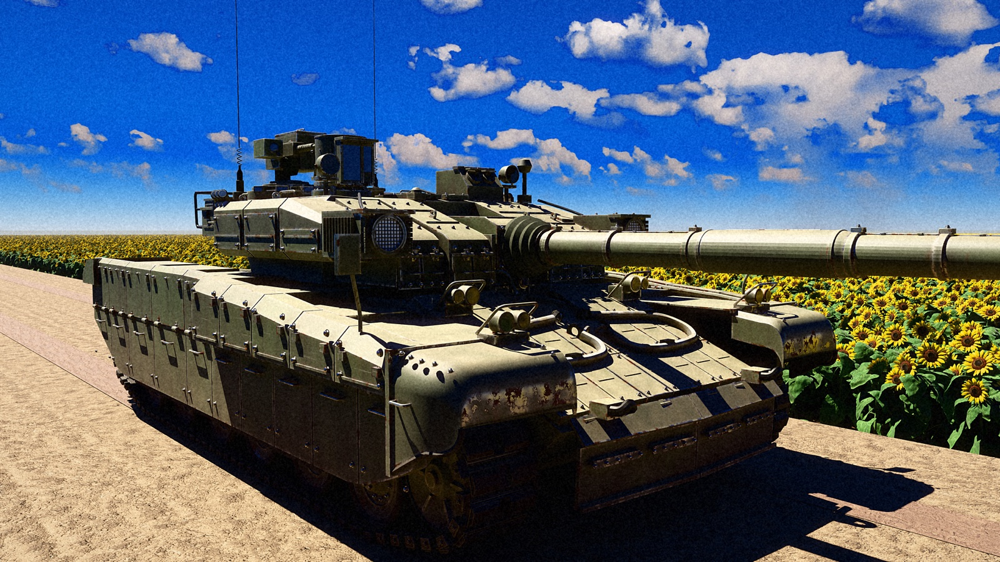
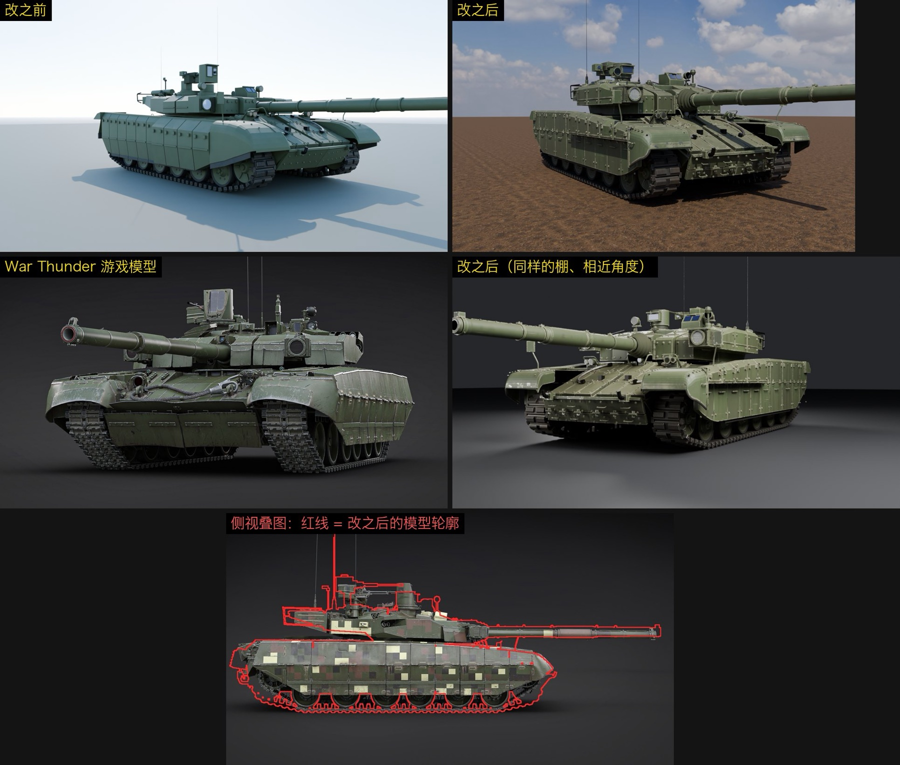
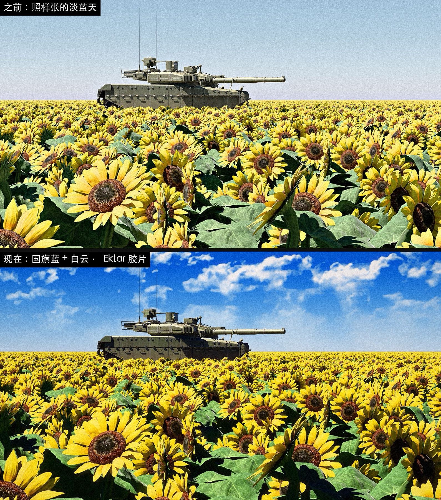

# T-84 · 向日葵花海

T-84 · Sunflower Field

[返回主页 / Back to profile](../README.md)

## 项目介绍

以 BM Oplot 主战坦克为对象，结合实车照片与侧视资料制作外观，并放进向日葵花田场景。蓝天、金黄花田与胶片颗粒共同构成这组画面。

An exterior modeling study of the BM Oplot tank using vehicle photographs and side-view references. A sunflower-field setting combines a blue sky, golden flowers and film grain.

**工具 / Tools**　Blender · Python · Cycles

## 成品展示 / Gallery

向日葵花海 · 主镜头 / Sunflower field · main view

沿田间道路的侧面视角 / Side view along the field road

车体与炮塔近景 / Hull and turret close-up

## 制作过程 / Making of

### 重测车体与炮塔比例

先用车辆尺寸资料建立模型标尺，再结合实车照片与 War Thunder 的侧视参考，核对炮塔高度、炮轴、侧裙与轮组的位置。初版偏长、偏扁的轮廓经过重做，并通过正交侧视叠图继续检查。

**Revising the hull and turret**

Vehicle dimensions establish the model’s scale. Photographs and a War Thunder side-view reference help check turret height, gun axis, side skirts and wheel positions. The early silhouette is revised and checked again with an orthographic overlay.

早期模型、修改版与游戏参考的比例检查。游戏参考版权归 Gaijin Entertainment。 / Proportion checks across early and revised models and a game reference. Game reference © Gaijin Entertainment.

### 硬表面细化与旧化

在大形稳定后加入反应装甲、螺栓、合页、拖曳钢缆和观瞄设备。军绿漆面按构件增加色差，再叠加积灰、泥污、雨水痕与掉漆；扶手、螺栓和装甲棱边增加露钢与高光。

**Hard-surface detail and weathering**

Once the main forms settle, the model gains armor blocks, bolts, hinges, tow cables and optical equipment. Per-part paint variation is combined with dust, mud, rain streaks and chipped edges. Exposed steel and highlights give small fittings more definition.

### 花田与长焦构图

主镜头按参考样张选择约 85 mm 的长焦，并抬高田间路基，让车体在花田上方保持可见。向日葵素材调整为多种生长姿态，再用实例化铺成花田，通过株高、朝向与间距变化减少重复感。

**Sunflower field and camera composition**

An approximately 85 mm lens follows the reference composition. A raised field road keeps the hull visible above the flowers. The sunflower asset is adapted into several growing poses, then instanced with variations in height, orientation and spacing.

### 天空方案与胶片后期

比较多种天空后，确定蓝天、白云与金黄花田的组合。Cycles 输出多机位 4K 静帧，再加入偏暖的曲线、轻微光晕、暗角和颗粒，同时保留干净版用于观察模型细节。

**Sky variations and film treatment**

Several sky treatments lead to the blue-sky, white-cloud and golden-field palette. Multi-angle 4K Cycles renders receive warm tonal curves, subtle halation, vignetting and grain. Clean versions are also retained for inspecting the model.

天空与整体色调的前后对照。 / Before-and-after comparison of the sky and overall color treatment.

## 素材与参考 / Credits

向日葵素材改编自 soufiane oujihi 的 Sunflower 3D（CC BY）；天空等部分素材来自 Poly Haven（CC0）。

Sunflower asset adapted from Sunflower 3D by soufiane oujihi (CC BY). Sky and selected materials from Poly Haven (CC0).

- [Sunflower 3D · soufiane oujihi](https://sketchfab.com/3d-models/sunflower-3d-966d0bee6e204d9ca927a601cf85cbc2)
